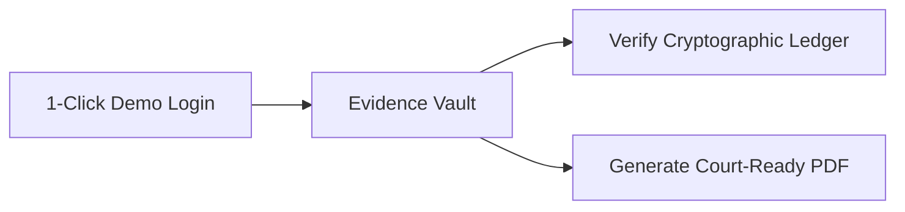

# 🛡️ EvidLock — Digital Evidence Chain-of-Custody Management System

[](https://evid-lock.vercel.app)
[](https://www.oracle.com/java/)
[](https://spring.io/projects/spring-boot)
[](https://angular.io/)
[](https://neon.tech)
[](https://en.wikipedia.org/wiki/SHA-2)

> **Architected & Developed by:** **Anirudha Koli**  
> **Official Live Application:** [https://evid-lock.vercel.app](https://evid-lock.vercel.app)

---

## 📌 Executive Summary

In criminal and cyber investigations, **over 70% of digital evidence admissibility challenges in court arise from compromised Chain of Custody**—such as unrecorded access, unauthorized custody transfers, file modification, or lack of cryptographic proof. Traditional cloud document platforms (SharePoint, Google Drive) fail judicial standards because files can be silently updated or deleted without immutable proof.

**EvidLock** is an enterprise-grade, cryptographically verified digital evidence management system purpose-built for law enforcement agencies, forensic laboratories, and courts. It ensures **zero-trust, end-to-end evidence integrity** by binding every piece of evidence to an append-only SHA-256 cryptographic hash chain, requiring dual-confirmation handovers, enforcing legal holds at the DAO layer, and generating tamper-evident court exhibits.

---

## 🌟 Quick Links for Evaluators & Judges

| Destination | Link | Description |
| :--- | :--- | :--- |
| 🚀 **Live Production App** | **[evid-lock.vercel.app](https://evid-lock.vercel.app)** | Fully deployed web app on Vercel |
| ⚙️ **Backend API Service** | **[evidlock.onrender.com](https://evidlock.onrender.com)** | Spring Boot REST API hosted on Render |
| 🗄️ **Cloud Database** | **Neon PostgreSQL 16** | Serverless relational storage with DB-level append triggers |
| 📄 **Legal Exhibit Generator** | Integrated OpenPDF engine | Court-ready Chain of Custody certificates with SHA-256 genesis hashes |

---

## 🎯 2-Minute Judge's Evaluation Script

To evaluate the live system on **[evid-lock.vercel.app](https://evid-lock.vercel.app)** without typing credentials:



1. **Step 1 — 1-Click Role Authentication**:
   - Open [https://evid-lock.vercel.app](https://evid-lock.vercel.app).
   - Click the **👑 Supervisor** or **⚖️ Auditor** button on the login screen to auto-fill authenticated credentials, then click **Sign In**.
2. **Step 2 — Audit the Cryptographic Hash Chain**:
   - Navigate to the **Evidence Vault** from the sidebar.
   - Click the **Chain / Ledger** button on any evidence item (e.g., *Encrypted USB Drive*).
   - Click **Verify Hash Chain** — watch the algorithm dynamically recalculate the entire SHA-256 linked chain from Genesis to latest block and display green verification checkmarks.
3. **Step 3 — Generate Court-Ready Evidence PDF**:
   - Click **Court-Ready PDF** on any evidence item.
   - A court exhibit document will instantly download containing the evidence genesis hash, custody transfer timestamps, officer signatures, and full legal declarations.

---

## 🔑 Demo Access Credentials

EvidLock implements the **Proxy-Pattern Role-Based Access Control (RBAC)** model. All accounts share the password: **`Web2324.`**

| Role | Email | Password | Pre-configured Agency | Forensic & Legal Authority |
| :--- | :--- | :--- | :--- | :--- |
| 👑 **Supervisor** (Admin) | `supervisor@evidlock.gov` | `Web2324.` | MPD-01 (Mumbai Police) | Master oversight, agency configuration, evidence disposition (only when no legal hold). |
| 🔍 **Investigator** | `investigator@evidlock.gov` | `Web2324.` | MPD-01 (Mumbai Police) | Case ingestion, initial evidence capture, custody transfer requests, case updates. |
| 📦 **Custodian** (Vault Chief) | `custodian@evidlock.gov` | `Web2324.` | SFL-02 (State Forensic Lab) | Evidence vault safekeeping, dual-step transfers, toggling hard **Legal Holds**. |
| ⚖️ **Auditor** | `auditor@evidlock.gov` | `Web2324.` | OIG-04 (Judicial Audit Cell) | **Strictly Read-Only**. Any attempt to mutate or alter state returns `HTTP 403 Forbidden`. |

---

## 🔐 Core Engineering & Cryptographic Innovations

### 1. Append-Only Cryptographic Hash Chain
Every lifecycle event (*Ingestion, Examination, Transfer, Legal Hold Change, Disposition*) generates an immutable block linked directly to its predecessor:
$$\text{eventHash} = \text{SHA-256}(\text{previousEventHash} + \text{actorId} + \text{action} + \text{timestamp} + \text{evidenceItemId})$$

- **Genesis Block**: Created at the instant of digital evidence ingestion with `previousEventHash = 0000...0000`.
- **Database Trigger Defense**: PostgreSQL enforces a strict database trigger (`trg_custody_events_append_only`) that aborts any `UPDATE` or `DELETE` query executed against the ledger table.

### 2. On-Retrieval File Integrity Engine
- Upon upload, a bit-level SHA-256 digest is generated and recorded.
- Whenever an evidence file is requested for download or analysis, the backend recalculates the checksum in a streaming pipeline before bytes are sent.
- **Tamper Alert System**: If a single bit in storage does not match the sealed hash, the download is halted with `HTTP 409 Conflict`, the status transitions to `COMPROMISED`, and an `INTEGRITY_ALERT` block is written to the ledger.

### 3. Dual-Confirmation Custody Handover Protocol
Evidence custody handovers cannot occur unilaterally:
1. Releasing custodian initiates a Transfer Request specifying case reason and authorized recipient.
2. The system sends an email notification and flags the request as `Pending`.
3. The recipient must log in, review the custody terms, and submit a **step-up re-authentication password** to accept the chain link.

### 4. Hard DAO-Layer Legal Hold Locks
When an investigator or prosecutor flags an item with `legalHold = true`:
- The item is shielded against deletion, purge, or archival.
- Even administrative supervisors cannot override or delete records under active Legal Hold without explicit release.

### 5. Official Court-Admissible PDF Exhibits
Powered by low-overhead OpenPDF templating:
- Full SHA-256 Genesis Hash and Vault Status badge.
- Chronological timeline table with block IDs, timestamps, involved officers, and block hashes.
- Legal declaration block ready for judge/jury review.

---

## 🏗️ System Architecture

```
┌────────────────────────────────────────────────────────────────────────┐
│                        FRONTEND CLIENT (SPA)                           │
│  Angular 17 • TypeScript • Bootstrap 5 • Chart.js • Responsive UI      │
│  Hosted on Vercel CDN (Edge Routing, Instant Global Delivery)           │
└───────────────────────────────────┬────────────────────────────────────┘
                                    │ HTTPS REST / JSON
┌───────────────────────────────────▼────────────────────────────────────┐
│                       BACKEND API ENGINE (REST)                        │
│  Java 17 • Spring Boot 3.2 • Spring Security • OpenPDF                 │
│  Hosted on Render.com (Multi-stage Dockerized Container)              │
│                                                                        │
│  ┌─────────────────────────┐  ┌─────────────────────────────────────┐  │
│  │ Security Proxy RBAC     │  │ Cryptographic Hash Chain Service    │  │
│  │ Supervisor/Investigator │  │ SHA-256 Ingestion & Verification    │  │
│  │ Custodian/Auditor (403) │  │ Genesis Block Linkage               │  │
│  └─────────────────────────┘  └─────────────────────────────────────┘  │
│  ┌─────────────────────────┐  ┌─────────────────────────────────────┐  │
│  │ File Integrity Engine   │  │ Dual-Key Handover Controller        │  │
│  │ Bit-level Checksums     │  │ Step-up Password Re-Authentication  │  │
│  └─────────────────────────┘  └─────────────────────────────────────┘  │
└───────────────────────────────────┬────────────────────────────────────┘
                                    │ JDBC Connection Pool (SSL Enabled)
┌───────────────────────────────────▼────────────────────────────────────┐
│                    RELATIONAL DATABASE (SERVERLESS)                    │
│  Neon PostgreSQL 16 (Port 5432)                                        │
│  - Table Trigger: trg_custody_events_append_only (Blocks UPDATE/DELETE)│
│  - Table Trigger: trg_evidence_items_legal_hold (Blocks Purge)         │
│  - Foreign Key Relational Integrity & Bcrypt Hashed Credentials        │
└────────────────────────────────────────────────────────────────────────┘
```

---

## 🧪 Automated Testing & Security Verification

EvidLock includes 13 automated unit and integration tests executing against real cryptographic engines and RBAC proxies:

```powershell
cd backend
.\mvnw.cmd test
```

```
[INFO] Results:
[INFO] Tests run: 13, Failures: 0, Errors: 0, Skipped: 0
[INFO] BUILD SUCCESS
```

| Test Class | Core Verification Domain |
| :--- | :--- |
| **`HashChainTest`** | Verifies genesis hash computation, intermediate link integrity, and simulates tampering with past blocks to ensure verification accurately catches the broken link. |
| **`FileIntegrityTest`** | Tests SHA-256 calculations against NIST vectors, verifies bit-identical file retrieval, and validates automatic download blocking when corrupted. |
| **`LegalHoldEnforcementTest`** | Enforces that active `legalHold = true` items cannot be deleted or purged by any user or API call. |
| **`SecurityProxyRbacTest`** | Validates that `UserAuditor` strictly intercepts mutations with `403 Forbidden`, while `UserSupervisor` and `UserInvestigator` retain appropriate domain authority. |

---

## 💻 Local Development Setup

If you wish to clone and run EvidLock locally:

### Prerequisites
- **Java 17+** JDK
- **Node.js 18+** & npm
- **PostgreSQL 14+** (running on port `5432`)

### 1. Clone the Repository
```bash
git clone https://github.com/Anirudhakoli282/EvidLock.git
cd EvidLock
```

### 2. Configure & Seed the Database
```powershell
psql -U postgres -c "DROP DATABASE IF EXISTS docufy;"
psql -U postgres -c "CREATE DATABASE docufy;"
psql -U postgres -d docufy -f "database/schema.sql"
psql -U postgres -d docufy -f "database/data.sql"
```

### 3. Start Backend API Server
```powershell
cd backend
.\mvnw.cmd spring-boot:run
```
*API available at `http://localhost:8081`.*

### 4. Start Frontend Application
```powershell
cd frontend
npm install
npm start
```
*Web App available at `http://localhost:4200`.*

---

## 📁 Repository Structure

```
EvidLock/
├── backend/
│   ├── src/main/java/com/evidlock/
│   │   ├── config/                # Global CORS & Security configuration
│   │   ├── controller/            # REST API endpoints & Auth handlers
│   │   │   └── service/           # Evidence, Case, Custody, Report REST services
│   │   ├── persistence/
│   │   │   ├── dao/postgres/      # Database Access Objects with legal hold guards
│   │   │   └── model/             # Domain entities & Proxy RBAC classes
│   │   └── service/
│   │       ├── crypto/            # HashChainService & FileIntegrityService
│   │       └── pdf/               # OpenPDF Court Report Generator
│   ├── src/test/java/com/evidlock/# Automated test suite (13 unit & integration tests)
│   ├── Dockerfile                 # Production Docker image build
│   └── pom.xml                    # Maven dependency descriptors
│
├── frontend/
│   ├── src/app/
│   │   ├── model/                 # TypeScript interfaces
│   │   ├── service/               # Angular HTTP services
│   │   └── view/
│   │       ├── _DASHBOARD/        # Analytics, charts, and retention alerts
│   │       ├── _DOCUMENTI/        # Vault table, chain modal, custody modals
│   │       ├── _LOGIN/            # 1-click credential authentication
│   │       └── _STATIC/           # Header, footer, copyright & legal notices
│   ├── angular.json
│   ├── package.json
│   └── vercel.json                # Vercel deployment & rewrite rules
│
├── database/
│   ├── schema.sql                 # Complete PostgreSQL schema with triggers
│   └── data.sql                   # Seed cases, agencies, and genuine SHA-256 chains
└── README.md                      # Project documentation
```

---

## 🏆 Key Takeaways for Judges

1. **Not a Prototype — A Complete, Deployed Solution**: Fully deployed with live frontend on Vercel, live REST API on Render, and live database on Neon PostgreSQL.
2. **True Cryptographic Chain of Custody**: Not just timestamps in a database—each custody action is hashed and cryptographically chained to its predecessor.
3. **Defense-in-Depth**: Immutability is enforced at the Frontend UI, REST Service layer, DAO layer, and PostgreSQL Trigger level.
4. **Court-Ready Utility**: Real legal value through automated, verifiable Chain of Custody PDF exhibit generation with digital hash signatures.

---

<p align="center">
  <b>EvidLock</b> — <i>Tamper-Evident Digital Evidence Chain-of-Custody</i><br>
  Created with passion by <b>Anirudha Koli</b>
</p>
